<div align="center">



<br/><br/>

[](https://subeedei.vercel.app/)
[](https://www.linkedin.com/in/subeedei-dolgio-0b0725388)
[](mailto:subeegod@gmail.com)
[](https://instagram.com/subeedei.d)
[](https://github.com/JinreP/JinreP/raw/main/assets/Subeedei_CV_EN.pdf)


</div>

<br/>

```bash
$ echo $MOTTO
Always building. Always improving.
```

## About

```yaml
name:      Subeedei (JinreP)
role:      Software Engineering student @ MUST, Ulaanbaatar
focus:     [full-stack web, backend systems, product development]
stack:     [Next.js, TypeScript, Node.js, Express, MongoDB, PostgreSQL, Tailwind]
learning:  [system design, Unity / C#, Django]
open_to:   [internships, collaborations, building useful products]
```

I build full-stack web applications end to end — database, API, UI and deployment — mostly for students, clubs and small organizations in Mongolia. Graduate of Pinecone Academy's 10-month full-stack program and 1st place winner at the PineQuest S3 hackathon.

<br/>

## Featured Projects

| Project | What it is | Stack | Status |
|---|---|---|---|
| **[EduBuzz](https://github.com/JinreP/QR-Kahoot)** · [demo](https://qr-kahoot.vercel.app) | Real-time live quiz platform (Kahoot-style) with QR-code room joining and teacher / student / admin roles | Next.js, Tailwind, Socket.IO, Express, MongoDB | Live |
| **Ascend** | Trilingual (MN / RU / EN) website for a MUST student self-development club: online admissions, member profiles, admin panel, news | Next.js, TypeScript, Tailwind | In development |
| **MUST International Research Club** | Website for an international-research student organization at MUST, built with a 10-person team; I own the UI/UX design and propose the full-stack Next.js architecture | Next.js, TypeScript | Planning |

More in my [repositories](https://github.com/JinreP?tab=repositories).

<br/>

## Journey

```text
$ git log --oneline --graph journey

* 2026-10  feat: building Ascend + International Research Club sites for MUST
* 2026-07  feat: EduBuzz — real-time quiz platform shipped to Vercel
* 2026-04  chore: graduated Pinecone Academy (10-month full-stack program)
* 2026-01  init: Software Engineering @ MUST, Department of Computer Science
* 2025-xx  feat: 1st place — PineQuest S3 hackathon
* 2025-06  init: joined Pinecone Academy
* 2024-06  chore: graduated School No. 2, Ulaanbaatar
```

<br/>

## Tech Stack

**Languages**


**Frontend**


**Backend & Database**


**Tools**


<br/>

## Metrics

<div align="center">


</div>

<br/>

## This week I spent my time on

<!--START_SECTION:waka-->
<!--END_SECTION:waka-->

<br/>

## GitHub Stats

<div align="center">


<br/>


<br/><br/>


<br/><br/>


<br/>

<picture>
  <source media="(prefers-color-scheme: dark)" srcset="https://raw.githubusercontent.com/JinreP/JinreP/output/github-snake-dark.svg" />
  <source media="(prefers-color-scheme: light)" srcset="https://raw.githubusercontent.com/JinreP/JinreP/output/github-snake.svg" />
  
</picture>

</div>

<br/>

## Recent Activity

<!--START_SECTION:activity-->
<!--END_SECTION:activity-->

<br/>

## Now Playing

<div align="center">

<a href="https://open.spotify.com/user/YOUR_SPOTIFY_USER_ID">
  
</a>

</div>

<br/>

## Achievements

- 1st place, PineQuest S3 hackathon — Pinecone Academy
- Pinecone Academy graduate — 10-month full-stack software engineering program (2025–2026)

<br/>

<div align="center">

```bash
$ exit
Thanks for stopping by. Open to internships and collaborations — subeegod@gmail.com
```

</div>
